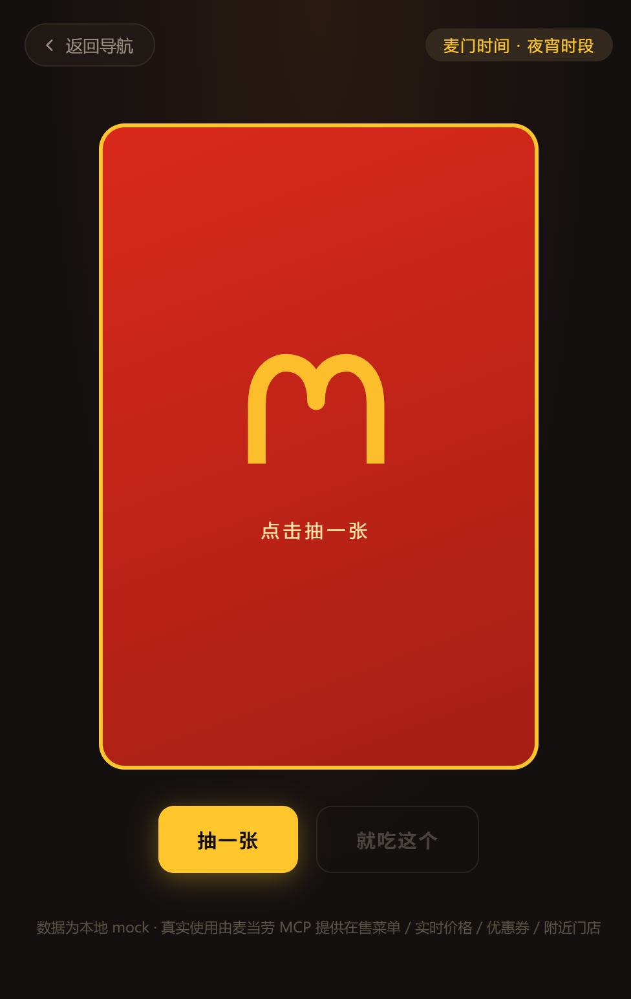
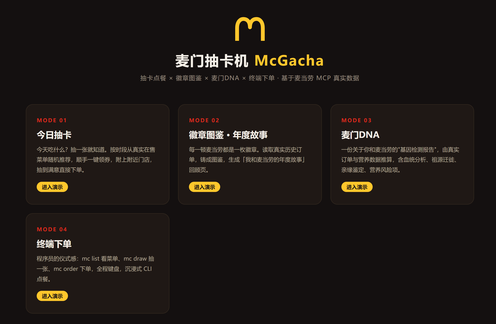
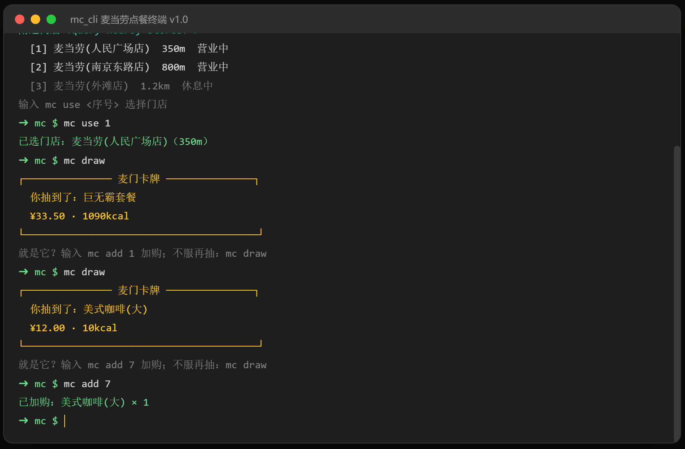
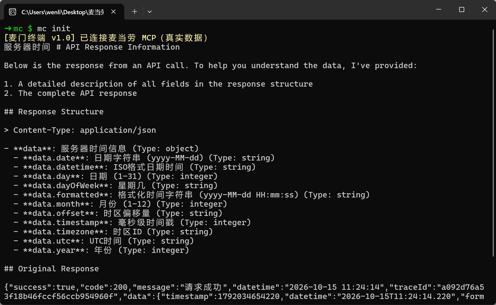

# 麦当劳抽卡机 McGacha

> 麦当劳今天吃什么？抽一张就知道了。
> 基于麦当劳 MCP 的创意 Skill：终端下单×抽卡点餐 × 徽章图鉴 × 麦门DNA &#x20;

一个把"吃麦当劳"变成抽卡游戏的 AI Skill。接入麦当劳官方 MCP 真实数据（在售菜单、实时价格、优惠券、附近门店、历史订单、营养成分），让 AI 帮你抽卡决定今天吃什么，顺便把每一顿麦当劳都变成可收集、可晒图、可回顾的仪式感。

## 效果预览

|                  抽卡                  |               导航              |                原生 CLI                |                桌面客户端               |
| :----------------------------------: | :---------------------------: | :----------------------------------: | :--------------------------------: |
|  |  |  |  |

> 截图为本地演示页/客户端实拍。演示页数据为 mock；真实使用由麦当劳 MCP 提供实时数据（菜单/价格/优惠券/门店/营养）。

## 四大玩法

### 1. 终端下单 · 程序员的仪式感

为开发者准备的沉浸式 CLI 点餐：

- VSCode / 终端风格的界面，全程键盘操作
- `mc list` 看菜单、`mc draw` 抽一张、`mc order` 下单，一条命令完成选店→选餐→用券→核价→下单
- 所有数据走麦当劳 MCP 真实接口，下单返回真实支付链接
- 两种玩法：AI 对话里的 CLI 模式，或 `cli/mc.mjs` 独立终端，或运行项目下mc.exe

### 2. 今日抽卡 · 吃什么不用想

对 AI 说一句"今天吃什么"，抽一张麦当劳卡牌：

- 按当前时段（早餐/正餐/夜宵）从**真实在售菜单**随机推荐套餐或单品
- 卡牌附带**真实价格、热量、蛋白质**等营养数据
- 电影级抽卡演出：SSR 金色爆发+震屏+放射光线
- 不满意就"再抽一张"
- 抽卡同时自动为你**一键领取可领优惠券**
- 附上**附近门店**列表（距离、营业状态），卡牌在哪吃一目了然

### 3. 徽章图鉴 · 麦当劳年度故事

每一顿麦当劳都是一枚徽章：

- 读取你的**真实历史订单**，把吃过的单品铸成徽章图鉴（巨无霸、麦旋风、板烧……集齐召唤神龙）
- 生成「我和麦当劳的年度故事」回顾页：第一次相遇的门店、点过最多次的最爱、深夜食堂时刻、年度消费与营养总览
- 图鉴与故事页均为本地生成的静态 HTML，零依赖、可直接保存分享

### 4. 麦门DNA

仿基因检测风格的趣味报告：

- **血统成分分析**：板烧血统、穷鬼基因、咖啡因依赖……由真实订单与营养数据推算
- **祖源迁徙**：你历年取餐门店构成的"麦门迁徙地图"
- **营养健康风险项**：基于真实营养成分（热量/脂肪/钠/蛋白质）的趣味化提示
- **亲缘鉴定**：输入好友的报告数据，测一测你们是不是"麦门亲兄弟"

## 安装与配置

### 前置条件

1. 支持 MCP 的 AI 客户端（Claude Desktop、Cursor 、Trae等）
2. 麦当劳 MCP Token（按大赛官方指引领取）

### 配置 MCP

复制 `mcp-config.example.json` 内容到你的客户端 MCP 配置中，并通过环境变量注入 Token：

```json
{
  "mcpServers": {
    "mcd-mcp": {
      "type": "streamableHttp",
      "url": "https://mcp.mcd.cn/mcp-servers/mcd-mcp",
      "headers": {
        "Authorization": "Bearer ${MCD_MCP_TOKEN}"
      }
    }
  }
}
```

> Token 一律通过环境变量 `MCD_MCP_TOKEN` 注入，不要写进任何配置文件或代码。

### 安装 Skill

将 `skill/SKILL.md` 作为自定义 Skill 导入你的 AI 客户端（设置 → Skills → 导入本地 SKILL.md），即可开始对话使用。

### 真实 CLI 客户端

`cli/mc.mjs` 是零依赖的 Node.js 独立终端（Node >= 18，无需 npm install），通过 JSON-RPC 直连麦当劳 MCP，把 `mc` 命令工具直接调用：

```powershell
$env:MCD_MCP_TOKEN = "你的Token"   # 设置 Token（仅当前窗口有效）
node cli\mc.mjs --probe            # 自检：握手 + 服务器时间，无任何写操作
node cli\mc.mjs                    # 进入交互终端
```

完整点餐流程：`mc stores 上海市 人民广场` → `mc use 1` → `mc draw`（或 `mc list`）→ `mc add 1` → `mc coupon` → `mc price` → `mc order` 后输 `YES` → `mc status` 查取餐码。

> ⚠️ `mc order` 会创建**真实订单**并产生真实支付，下单前需手输 YES 二次确认；体验流程跑到 `mc price` 即可。

### 原生 CLI 桌面版

`cli-native/` 是 Rust 编写的原生控制台客户端：零运行时依赖、真终端体验（ANSI 彩色输出），双击即用，面向不想用开发工具的用户。产物：[cli-native/dist/mc.exe](./cli-native/dist/mc.exe)

## 使用示例

| 你说          | Skill 做什么                           |
| ----------- | ----------------------------------- |
| 今天吃什么？      | 判断时段 → 查附近门店 → 拉真实菜单 → 抽卡 → 附优惠券和门店 |
| 帮我领券        | 调用 auto-bind-coupons 一键全领           |
| 生成我的麦门年度故事  | 拉历史订单 → 铸徽章图鉴 → 生成年度回顾 HTML         |
| 给我一份麦门DNA报告 | 订单+营养+门店足迹 → 生成 DNA 检测报告页           |
| 用终端点餐       | 进入 CLI 模式，命令行完成真实下单                 |

## 真实 MCP 链路实测

2026-10-14 23:41（MCP 服务器时间，`now-time-info` 返回）对 mcd-mcp 完成一次全链路实测，以下均为真实接口返回：

| 步骤      | 工具                                        | 真实返回摘要                                                           |
| ------- | ----------------------------------------- | ---------------------------------------------------------------- |
| 1. 餐段判断 | `now-time-info`                           | 2026-10-14 23:41:51 · 周三 · GMT+8                                 |
| 2. 附近门店 | `query-nearby-stores`                     | 上海人民广场周边 5 家；最近「上海黄浦华旭国际大厦餐厅」距离 144m、营业中，storeCode `1450713`     |
| 3. 在售菜单 | `query-meals`                             | 15 个分类 90+ 商品实时在售：巨无霸四件套 ¥32（原价 ¥58.5）、龙焰鸡腿堡三件套 ¥26.9（原价 ¥47.5）等 |
| 4. 一键领券 | `available-coupons` + `auto-bind-coupons` | 查得可领 3 张，全部领取成功：免费脆薯饼、人气麦旋风买一送一、9.9 元中杯冰美式                       |
| 5. 券后核价 | `calculate-price`                         | 巨无霸四件套 + 麦咖啡冰美式中杯（挂 9.9 元券）：原价 ¥77.50 − 优惠 ¥9.10 = **¥68.40**    |

核价步骤真实返回（节选，金额已由分转元）：

```json
{
  "productList": [
    { "productCode": "9900000888", "productName": "巨无霸四件套", "quantity": 1, "subtotal": 5850 },
    { "productCode": "507411", "productName": "麦咖啡™冰美式中杯", "quantity": 1, "originalSubtotal": 1900, "subtotal": 990 }
  ],
  "originalPrice": 7750,
  "discount": 910,
  "price": 6840,
  "traceId": "12ff97b4c222d7e5ac679844e70f9b66"
}
```

Skill 四大玩法中的每一环（选店、抽卡、领券、核价、下单）走的都是这条真实链路。

## 演示

`demo/` 目录为零依赖静态演示（纯 HTML/CSS/JS，无 CDN、无外部请求），直接双击打开：

- [demo/index.html](./demo/index.html) — 导航
- [demo/gacha.html](./demo/gacha.html) — 抽卡机（演示数据为 mock，真实使用由 MCP 提供数据）
- [demo/story.html](./demo/story.html) — 徽章图鉴 · 麦门年度故事
- [demo/dna.html](./demo/dna.html) — 麦门DNA （含亲缘鉴定小工具）
- [demo/cli.html](./demo/cli.html) — 终端下单（可交互 CLI：mc help 查看命令）

## 目标用户

- 每天纠结"今天麦当劳吃什么"的打工人
- 喜欢收集、图鉴、成就体系的玩家
- 爱晒年度报告/人格测试类内容的社交用户
- 想在终端里完成一切的程序员

## 目录结构

```
├── README.md                  # 本文件
├── CONTEST_DECLARATION.md     # 参赛声明（官方原文，未修改）
├── MCP_INTEGRATION.md         # MCP 接入说明与调用流程
├── mcp-config.example.json    # MCP 配置示例（Token 用环境变量占位）
├── workbuddy.md               # WorkBuddy 使用说明
├── skill/
│   └── SKILL.md               # Skill 定义（四大功能工作流）
├── demo/                      # 零依赖静态演示页（纯 HTML/CSS/JS，无 CDN）
│   ├── index.html
│   ├── gacha.html             # 抽卡机（电影级 3D 翻转+SSR 特效）
│   ├── story.html             # 徽章图鉴 · 麦门年度故事
│   ├── dna.html               # 麦门DNA
│   └── cli.html               # 终端下单（可交互 CLI）
├── cli/
│   └── mc.mjs                 # Node.js 独立 CLI（零依赖，Node >= 18）
├── cli-native/                # Rust 原生 CLI（单文件 exe，~1.5MB）
│   ├── src/main.rs
│   ├── Cargo.toml
│   └── dist/mc.exe            # 编译产物
└── docs/
    └── screenshots/           # README 效果预览截图
```

## 参赛信息

本项目为「麦当劳程序员节创意开发大赛」参赛作品，由作者独立开发，非麦当劳官方产品。餐品信息、价格及供应状态以麦当劳官方渠道实时结果为准；营养相关内容仅为趣味展示，不构成专业建议。

## License

MIT License
